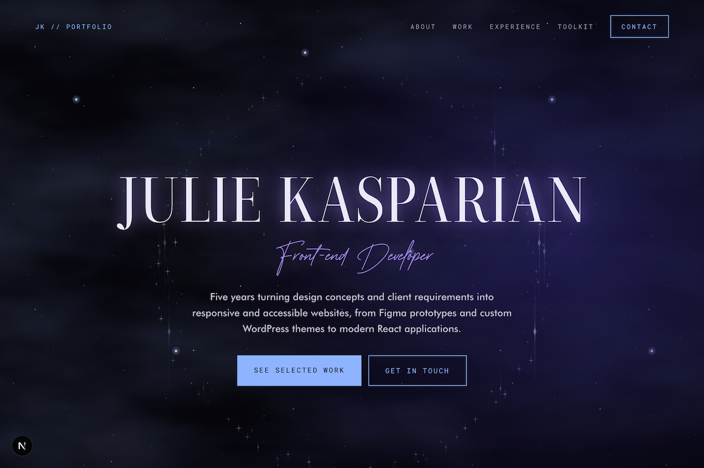

# Julie Kasparian — Portfolio

Single-page portfolio at [jkas1.github.io](https://jkas1.github.io/).



**Stack:** [Next.js](https://nextjs.org/) · [TypeScript](https://www.typescriptlang.org/) · [Tailwind CSS](https://tailwindcss.com/)

## Structure

| Path | Purpose |
|------|---------|
| `app/` | App Router (`layout.tsx`, `page.tsx`, `globals.css`) |
| `components/` | Page sections, nav, illustrations, star-border frames |
| `lib/content.ts` | Copy, projects, experience, toolkit data |
| `lib/fonts.ts` | Font preload URLs (`FONT_PRELOADS` → `app/layout.tsx`) |
| `lib/layout.ts` | Shared layout tokens (wrap width, section spacing) |
| `public/fonts/` | Self-hosted faces (display, body, script, mono) |
| `public/images/decor/` | Section icons and hero/contact star-border SVGs |
| `public/images/portfolio/` | Project screenshots |
| `public/static/` | Resume PDF |

All static assets live under `public/` only.

## Develop

```bash
npm install
npm run dev
```

Open [http://localhost:3000](http://localhost:3000).

Turbopack is the default (`next dev --turbopack`). If dev misbehaves, use `npm run dev:webpack`.

## Production build

Static export for GitHub Pages:

```bash
npm run build
```

Output is in `out/`. Deploy that folder to your Pages branch (for example, copy `out` contents to `gh-pages` or your user-site repo).

## Tech notes

- `next.config.ts` uses `output: "export"` and unoptimized images for static hosting.
- Fonts are self-hosted via `@font-face` in `globals.css` (no `next/font/google`).
- Night sky (tiled star fields, bright accents, shooting star) and section decor are CSS and SVG in `app/globals.css` and `public/images/decor/`.